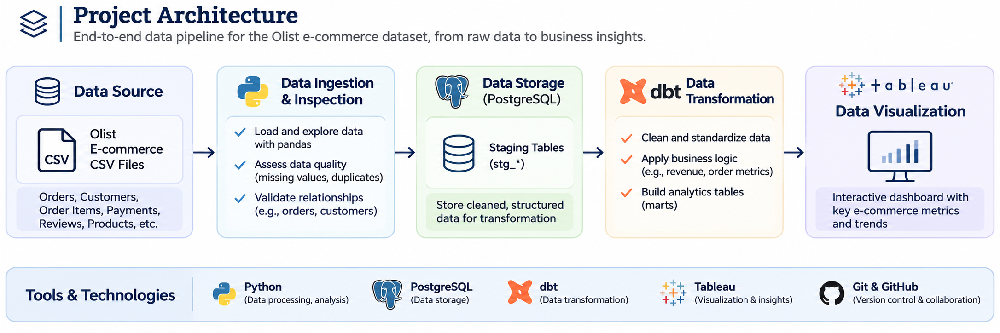
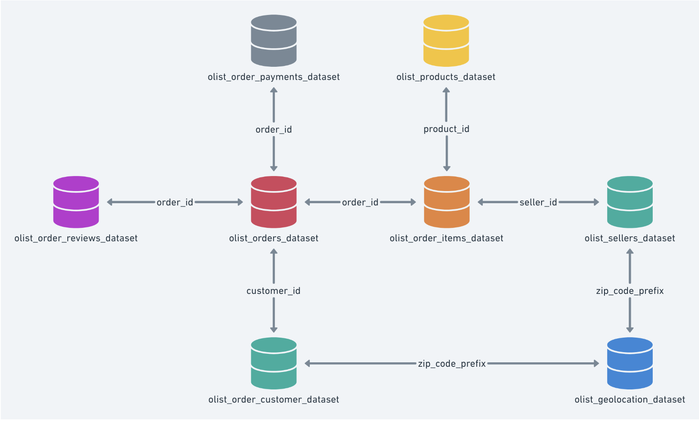
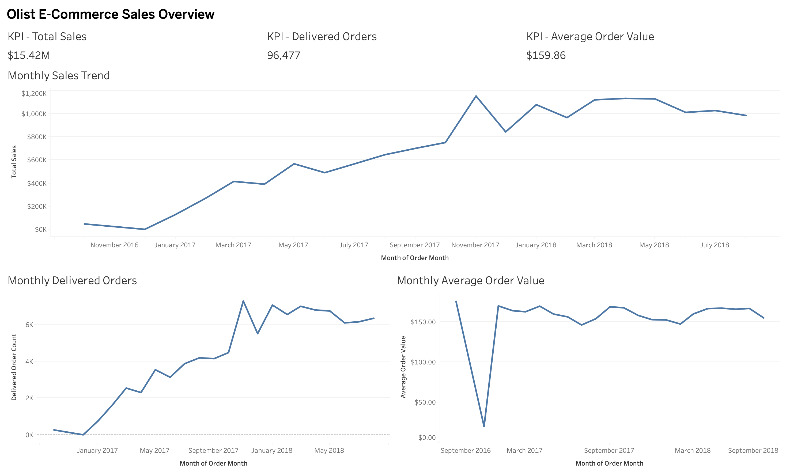

# Retail Sales Data Pipeline

## Project Overview

This project builds an end-to-end data engineering pipeline using retail e-commerce data.

The pipeline will ingest raw data, clean and validate it with Python, store it in PostgreSQL, transform it into analytics-ready tables using dbt, and present business insights through Tableau.

## Project Architecture

The pipeline processes raw Olist e-commerce data through Python, PostgreSQL, and dbt to produce analytics-ready data for Tableau dashboards.

## Project Goals

- Build a repeatable ETL pipeline using Python.
- Store and manage data using PostgreSQL and SQL.
- Transform data into fact and dimension tables using dbt.
- Implement data quality checks and error handling.
- Practice incremental data loading and safe pipeline reruns.
- Use AWS S3 for raw data storage.
- Create an interactive Tableau dashboard.
- Document the project and maintain it using Git and GitHub.

## Technology Stack

- Python
- SQL
- PostgreSQL
- dbt Core
- Docker
- AWS S3
- Tableau
- Git and GitHub

## Project Status

Planning and initial setup.

## Data Source

The project will use the Brazilian E-Commerce Public Dataset by Olist.

Dataset: https://www.kaggle.com/datasets/olistbr/brazilian-ecommerce

### Data Schema

## Local Development Setup

### Technologies

- Python
- PostgreSQL 17
- SQLAlchemy
- psycopg
- python-dotenv
- pandas

### Database Configuration

The project uses a local PostgreSQL database named `retail_sales`.

Database connection settings are stored in a local `.env` file and are excluded from version control.

Required environment variables:

- `DB_HOST`
- `DB_PORT`
- `DB_NAME`
- `DB_USER`
- `DB_PASSWORD`

## Project Progress

- [x] Downloaded and inspected the Olist e-commerce dataset
- [x] Completed initial data-quality and relationship checks
- [x] Installed and started PostgreSQL locally
- [x] Created the `retail_sales` database
- [x] Verified the Python-to-PostgreSQL connection
- [x] Created nine PostgreSQL staging tables
- [x] Built Python loaders for all nine source datasets
- [x] Loaded and verified all nine staging tables
- [x] Documented data-quality findings and staging validation
- [x] Build data transformations using dbt Core
- [x] Develop data-quality and transformation tests
- [x] Create reporting tables and analytical data models
- [ ] Build Tableau dashboards
- [ ] Containerize the pipeline with Docker
- [ ] Integrate AWS S3 for data storage

## Tableau Sales Dashboard

The Tableau dashboard provides an overview of Olist e-commerce sales performance from September 2016 through September 2018.

### Key Performance Indicators

- **Total Sales:** $15.42M
- **Delivered Orders:** 96,477
- **Average Order Value:** $159.86

### Dashboard Visualizations

- **Monthly Sales Trend:** Tracks total sales over time.
- **Monthly Delivered Orders:** Shows the number of delivered orders each month.
- **Monthly Average Order Value:** Shows the average payment value per delivered order by month.

### Metric Definitions

- **Total Sales:** The sum of payment values for delivered orders with available payment summaries.
- **Delivered Orders:** The number of delivered orders with available payment summaries.
- **Average Order Value:** Total sales divided by delivered orders.

Sales are grouped by the order purchase month. These metrics represent payment values for delivered orders; they are not net revenue after refunds, fees, or other adjustments.

### Dashboard Preview

